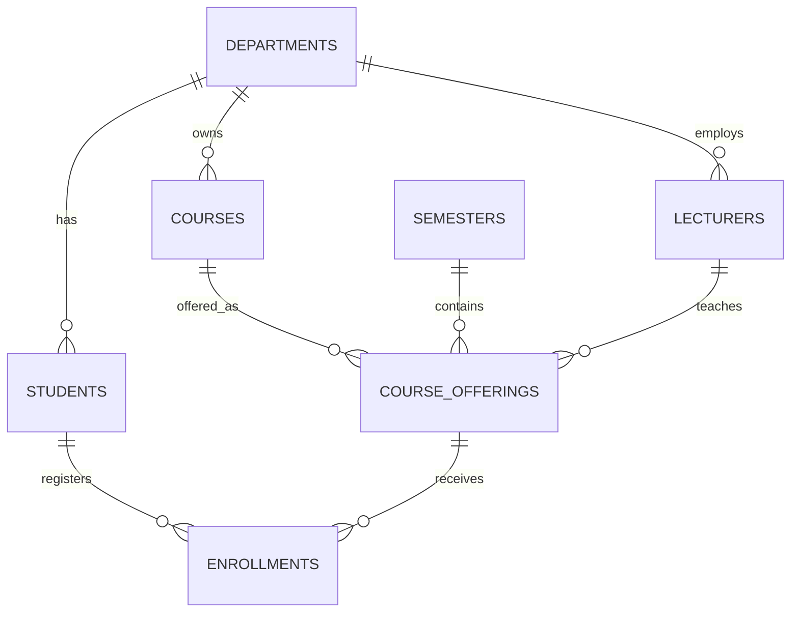

ER model

The `enrollments` table resolves the many-to-many relationship between students and course offerings. Its unique constraint on `(student_id, offering_id)` prevents a student from registering for the same offering twice.
